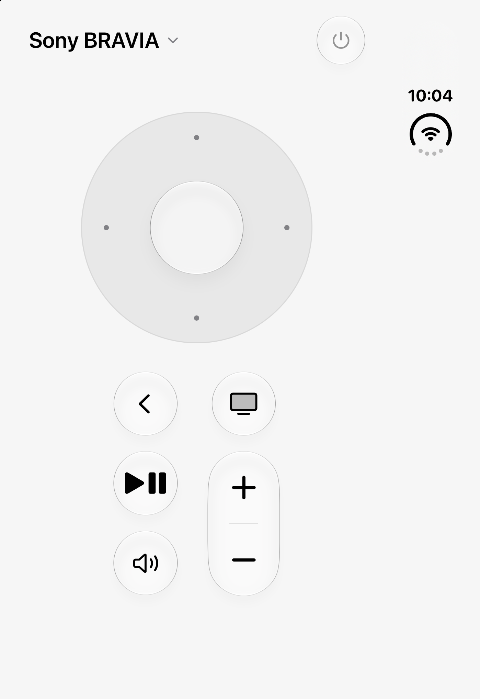
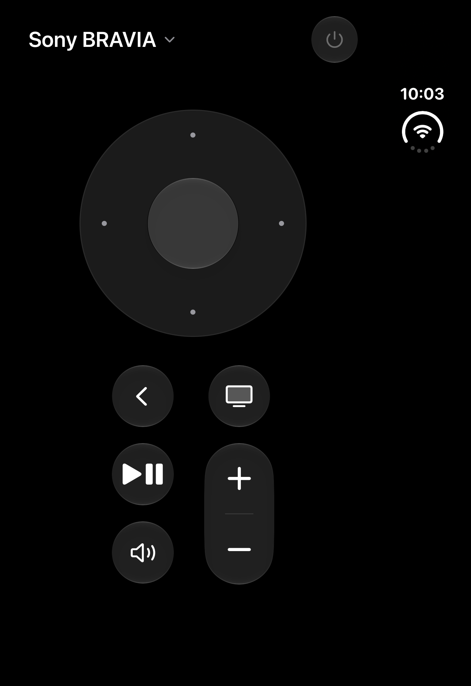
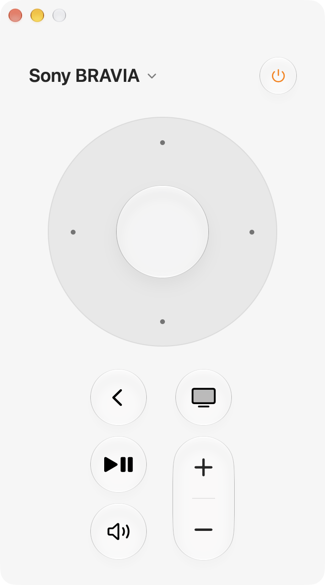
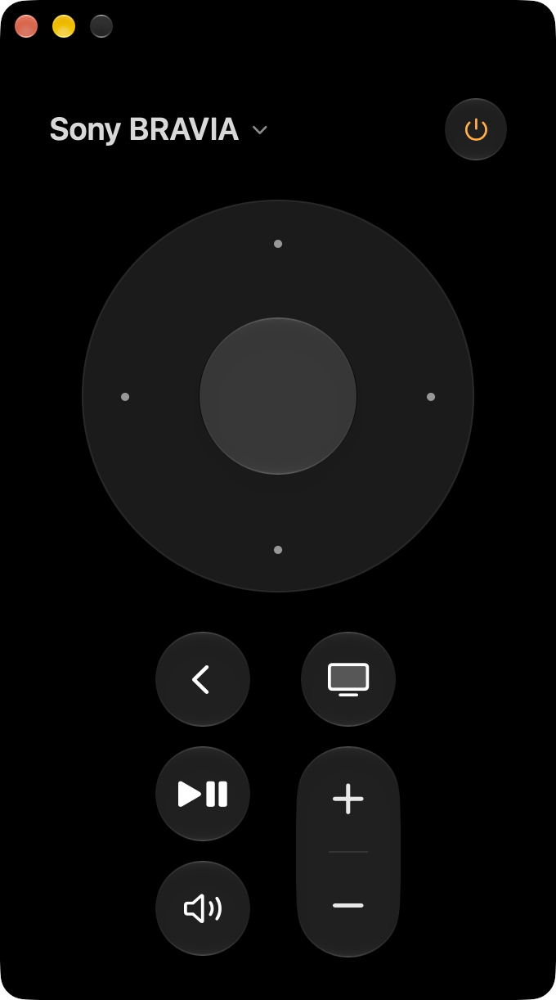
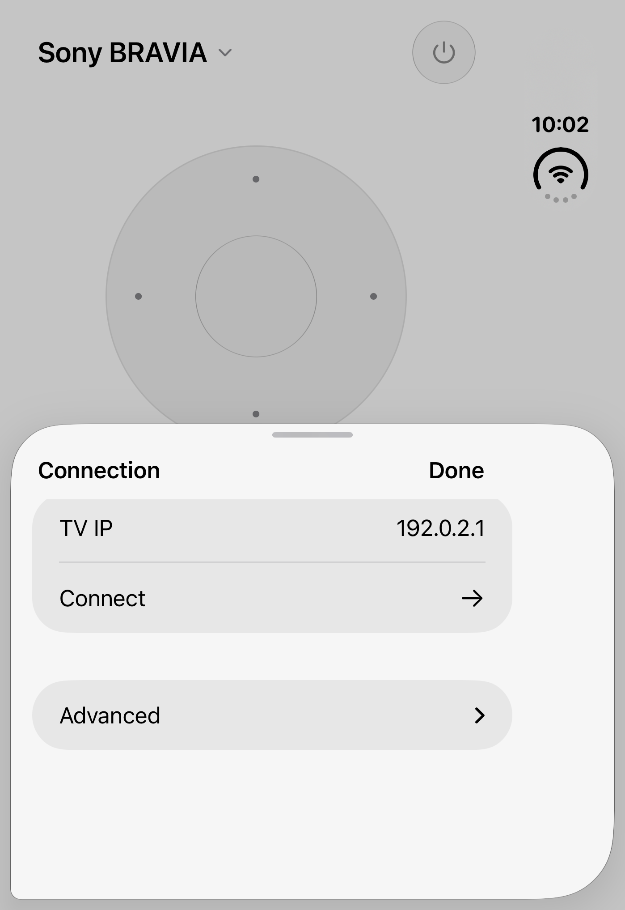
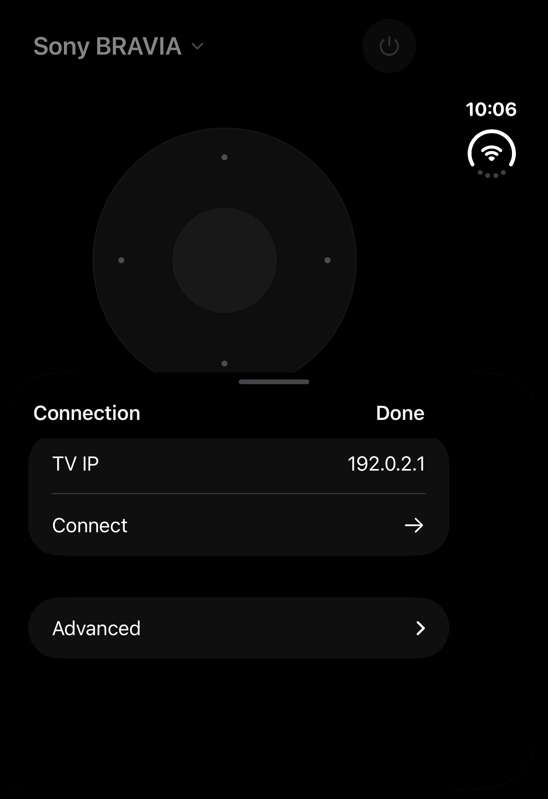
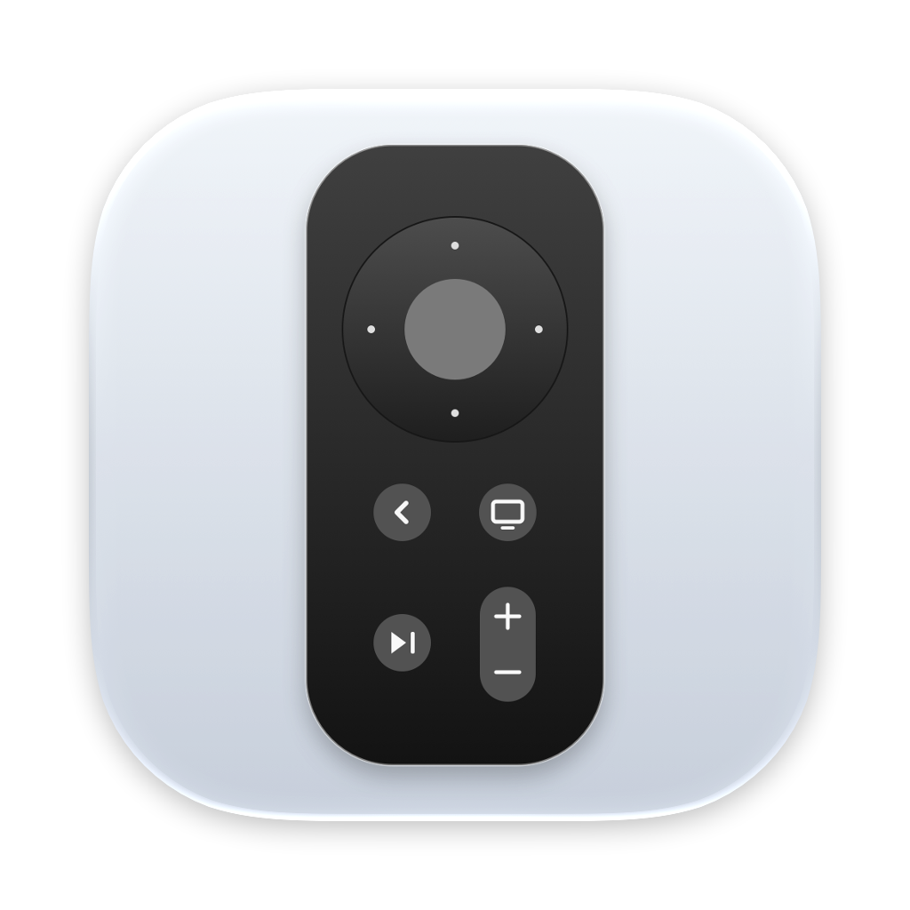

English | [简体中文](README.md)

# Sony Remote

A native, ad-free Sony BRAVIA LAN remote for iPhone and Mac, built with SwiftUI and native Liquid Glass.

> Note: the rest of the documentation in this repository (such as `docs/`) is written in Chinese.

## Screenshots

| iPhone · Light | iPhone · Dark |
| :---: | :---: |
|  |  |

| Mac · Light | Mac · Dark |
| :---: | :---: |
|  |  |

## Features

- Round directional pad: directional keys, confirm, swipe navigation, and repeat-on-hold.
- Back, Home, Play/Pause, Mute, TV volume up/down, and Power.
- Automatically follows the system Light / Dark Mode — no separate theme switch setting.
- First-time four-digit PIN pairing; credentials are stored in the on-device Keychain. The TV's PSK mode is also supported.
- The Mac Control Center offers a Sony Remote entry; click it to open the full remote window.
- No ads, no analytics SDKs, no accounts, and no cloud services.

App launch, the input source list, number keys, channel keys, and "Now Playing" information are out of scope for this project.

## Connection Setup and Icon

| Connection · Light | Connection · Dark | App Icon |
| :---: | :---: | :---: |
|  |  |  |

[Design references](docs/design-references.md)

## Usage and Building

### iPhone

1. Open `apps/ios/sonytvremote.xcodeproj` in Xcode and select the `sonytvremote` scheme.
2. Before installing to a real device, choose your own Team under Signing & Capabilities; the public project does not include developer signing settings.
3. Connect the phone and the TV to the same LAN. On first use, enter the TV's IP address in Connection and tap Connect.
4. If the TV requires authorization, enter the four-digit PIN shown on the TV and tap Pair TV. If the pairing code expires, tap Show code again.

The minimum iOS version is 17; iOS 26+ uses native Liquid Glass, while earlier versions use system materials. When Reduce Transparency is enabled, opaque surfaces are used.

### Mac

Open `apps/macos/SonyRemote.xcodeproj` in Xcode, select the `SonyRemote` scheme and your own Team, and run it on My Mac. The minimum macOS version is 26.

After the connection is complete, search for Sony Remote in the Control Center's Edit Controls and add it. From then on, simply tap the entry to open the remote. See the [Mac notes](apps/macos/README.md) for details.

A fresh install does not pre-fill a private IP. An installed version keeps the address and pairing stored on the device; to change the address, tap the TV name at the top. The settings page is in English only, and PSK is tucked under Advanced.

Sony's play and pause are separate commands, so the play button offers a Play / Pause menu. Text input uses the TV's on-screen keyboard; waking from deep standby is not implemented or verified.

## Project Structure

- `apps/ios/`: the iPhone project, plus the communication layer, key models, ViewModels, and components shared by both platforms.
- `apps/macos/`: the Mac window, connection settings, Control Center extension, and UI tests; it directly references the shared Swift files.
- `packages/Appearance/`: color assets for Light and Dark Mode shared by both platforms.
- `tools/render-app-icons.swift`: a reproducible vector drawing script for the original app icons.
- `docs/`: sources, privacy, design, and demo screenshots.

## Testing

```sh
xcodebuild -project apps/ios/sonytvremote.xcodeproj -scheme sonytvremote \
  -destination 'platform=iOS Simulator,name=<your installed simulator>' \
  -parallel-testing-enabled NO -collect-test-diagnostics never \
  -only-testing:sonytvremoteTests -only-testing:sonytvremoteUITests/RemoteUITests test
```

For Mac tests, see the [Mac notes](apps/macos/README.md). The communication tests use simulated Sony responses and cover PIN/PSK, credential storage and isolation, IRCC key codes, mute state, and an unset address; UI tests do not connect to a real TV.

## Source and License

This project is based on [ug2454/sonytvremote](https://github.com/ug2454/sonytvremote) and is licensed under Apache-2.0. See [LICENSE](LICENSE), [NOTICE](NOTICE), and the [modification notes](docs/upstream.md).

For privacy and storage scope, see [docs/privacy.md](docs/privacy.md); for the verification scope, see [design-qa.md](design-qa.md).
