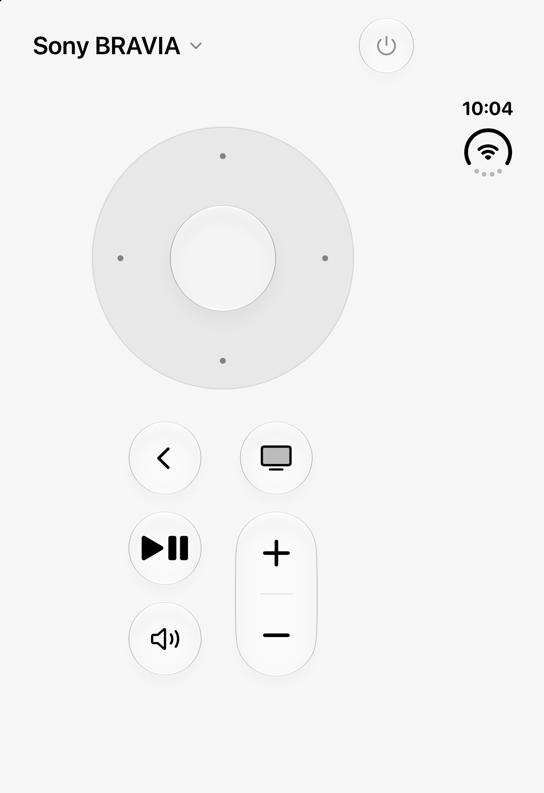
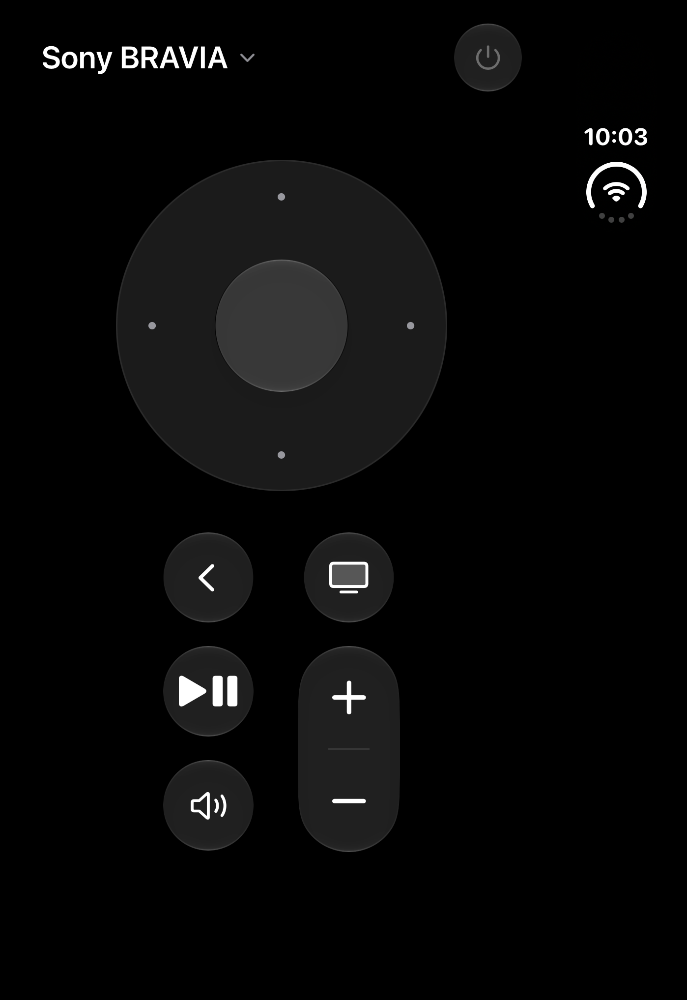
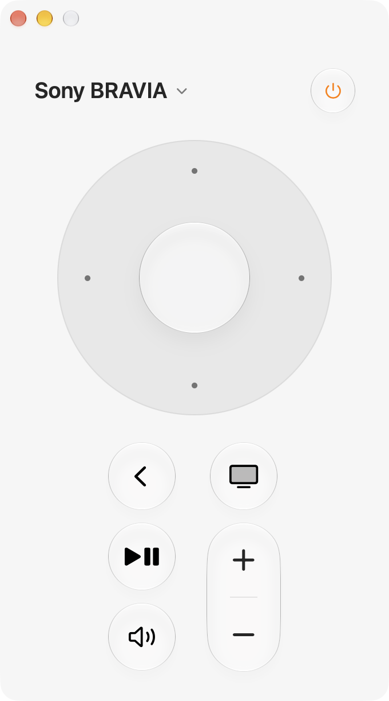
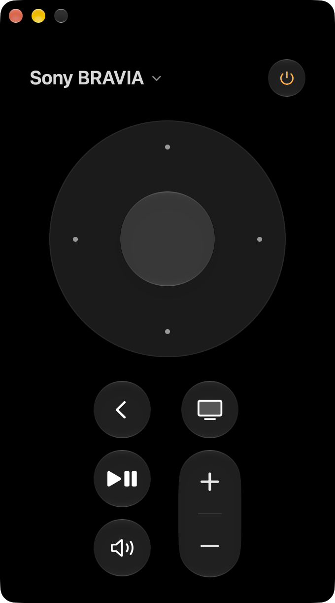
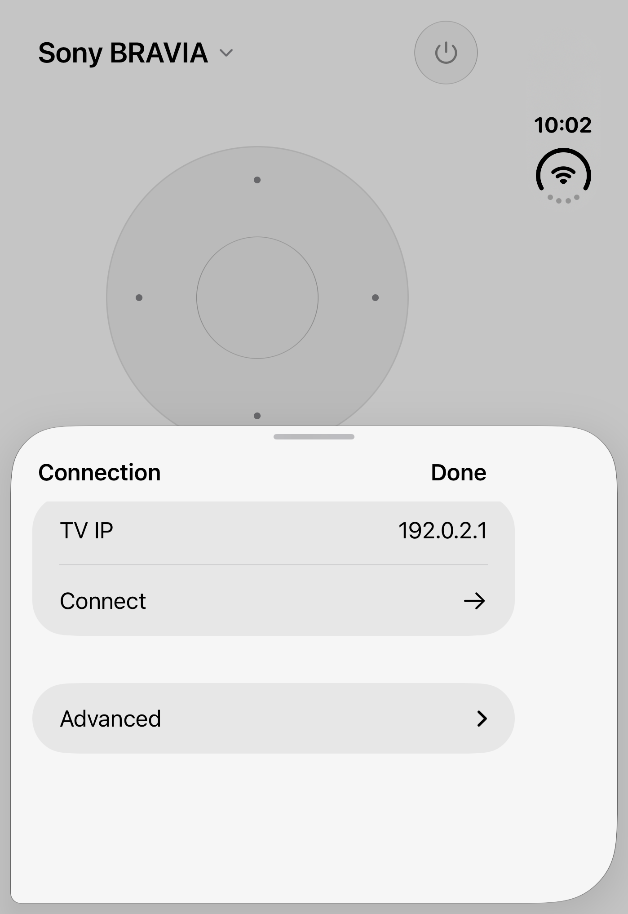
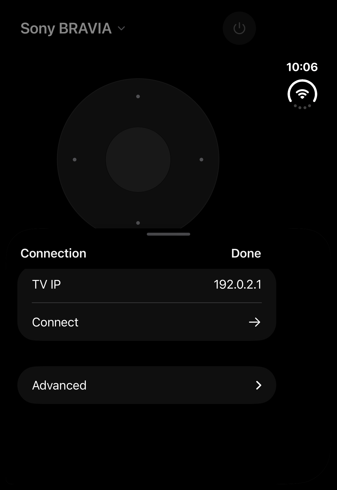
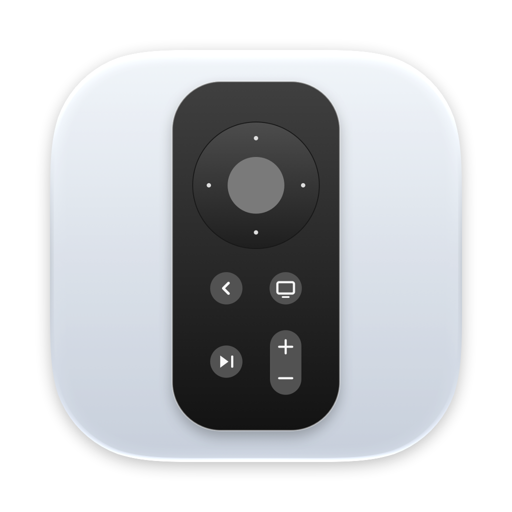

# Sony Remote

无广告的原生 Sony BRAVIA 局域网遥控器，支持 iPhone 和 Mac，使用 SwiftUI 与原生 Liquid Glass。

## 画面

| iPhone · Light | iPhone · Dark |
| :---: | :---: |
|  |  |

| Mac · Light | Mac · Dark |
| :---: | :---: |
|  |  |

## 功能

- 圆形方向盘：方向、确认、滑动导航与按住连发。
- 返回、首页、播放／暂停、静音、电视音量加减及电源。
- 自动跟随系统 Light / Dark Mode，没有额外的主题切换设置。
- 首次使用四位 PIN 配对，授权保存在本机 Keychain；也支持电视的 PSK 模式。
- Mac 控制中心提供一个 Sony Remote 入口，点击开启完整遥控器窗口。
- 没有广告、分析 SDK、帐号或云端服务。

应用程序启动、输入源清单、数字键、频道键及「正在播放」资讯不在本项目的范围内。

## 连接设置与图标

| Connection · Light | Connection · Dark | App Icon |
| :---: | :---: | :---: |
|  |  |  |

[设计参考](docs/design-references.md)

## 使用与编译

### iPhone

1. Xcode 开启 `apps/ios/sonytvremote.xcodeproj`，选 `sonytvremote` scheme。
2. 安装到实机前，在 Signing & Capabilities 选自己的 Team；公开工程不包含开发者签名设置。
3. 手机与电视连到同一局域网，首次在 Connection 填入电视 IP，点 Connect。
4. 若电视需要授权，输入电视显示的四位 PIN，点 Pair TV。配对码过期可点 Show code again。

最低 iOS 17；iOS 26+ 使用原生 Liquid Glass，较早版本使用系统材质。降低透明度时使用不透明表面。

### Mac

Xcode 开启 `apps/macos/SonyRemote.xcodeproj`，选 `SonyRemote` scheme 和自己的 Team，执行到 My Mac。最低 macOS 26。

完成连接后，在控制中心的 Edit Controls 搜寻 Sony Remote 并加入。日后直接点入口即可开启遥控器。详见 [Mac 说明](apps/macos/README.md)。

首次安装不预填私人 IP。已安装版本保留装置内储存的地址与配对；更改地址请点上方电视名称。设置页直接使用英文，PSK 收在 Advanced。

Sony 的播放与暂停是分开指令，因此播放按钮提供 Play / Pause 选单。文字输入使用电视屏幕键盘；深度待机唤醒未实作或验证。

## 项目结构

- `apps/ios/`：iPhone 工程，以及两端共用的通讯、按键模型、ViewModel 和组件。
- `apps/macos/`：Mac 窗口、连接设置、控制中心扩展与 UI 测试；直接引用共用 Swift 文件。
- `packages/Appearance/`：两端共用的深浅色色彩资源。
- `tools/render-app-icons.swift`：原创图标的可重现向量绘制脚本。
- `docs/`：来源、隐私、设计和演示截图。

## 测试

```sh
xcodebuild -project apps/ios/sonytvremote.xcodeproj -scheme sonytvremote \
  -destination 'platform=iOS Simulator,name=<已安装的模拟器>' \
  -parallel-testing-enabled NO -collect-test-diagnostics never \
  -only-testing:sonytvremoteTests -only-testing:sonytvremoteUITests/RemoteUITests test
```

Mac 测试见 [Mac 说明](apps/macos/README.md)。通讯测试使用模拟 Sony 回应，涵盖 PIN／PSK、授权保存与隔离、IRCC 按键码、静音状态和未设置地址；UI 测试不连接真实电视。

## 来源与授权

本项目基于 [ug2454/sonytvremote](https://github.com/ug2454/sonytvremote) 修改，使用 Apache-2.0。见 [LICENSE](LICENSE)、[NOTICE](NOTICE) 和 [修改说明](docs/upstream.md)。

隐私与储存范围见 [docs/privacy.md](docs/privacy.md)；验证范围见 [design-qa.md](design-qa.md)。
